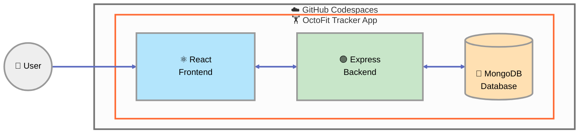

## Step 0: Setup your GitHub Codespace

### :hourglass: Activity: Start your GitHub Codespace

Right-click the below button to open the **Create Codespace** page in a new tab, confirm the **Repository** field is your copy of the exercise, and create the Codespace using the default configuration.

[](https://codespaces.new/{{full_repo_name}}?quickstart=1)

> [!NOTE]
> The Codespace will take a few minutes to provision. While it's setting up, continue reading below to learn about the application we'll be building!

## Step 1: Read the architecture and establish a test baseline

Welcome @{{ login }}! You are extending OctoFit Tracker for a school fitness program. Start by reading the contracts and making the current failures reproducible.

### Great! What are we building today?

In this exercise, you will build **OctoFit Tracker**, a fitness application for a school fitness program with activity tracking, team management, a competitive leaderboard, and personalized workout suggestions. The application has a React frontend, an Express backend, and a MongoDB database.



<details>
<summary>❓What are React, Express, and MongoDB?</summary><br/>

**⚛️ React** is a JavaScript library for building user interfaces. It allows you to create interactive, dynamic web applications with reusable components. React updates the UI efficiently whenever your data changes, making it perfect for building responsive frontend applications.

**🟢 Express** is a minimal web framework for Node.js. In this exercise it is written in TypeScript and exposes the OctoFit REST API under `/api`, owning request validation, business rules, status codes, and error responses.

**🍃 MongoDB** is a NoSQL database that stores data in flexible, JSON-like documents instead of rigid tables. In this exercise, Mongoose schemas define the rules that every stored record must follow.

Together, these three technologies form a powerful stack for building modern, scalable applications!

</details>

### 📖 Theory: Contracts before generation

Agent mode is most reliable when it has explicit boundaries and executable acceptance criteria. The architecture document explains ownership across React, Express, and MongoDB, while the failing test suites show which behavior is intentionally incomplete. Reading both before editing lets you ask Copilot for a bounded plan instead of a broad application-generation prompt.

### ⌨️ Activity: Read the architecture and establish a test baseline

1. Your Codespace should now be ready. If not, go back to the tab where you opened it and wait for Visual Studio Code to load.

1. In the Codespace, create and publish a working branch named `build-octofit-app`.

1. Check whether MongoDB is running before you run integration tests.

   > 
   >
   > ```bash
   > ps aux | grep mongod
   > ```

1. Install both tier dependencies and capture the red test baseline.

   > 
   >
   > ```bash
   > npm ci --prefix octofit-tracker/backend
   > npm ci --prefix octofit-tracker/frontend
   > npm test --prefix octofit-tracker/backend
   > npm test --prefix octofit-tracker/frontend
   > ```

1. Locate the `AGENTS.md` file in the file explorer and read it. It gives the Copilot agent the boundaries and standards to follow in this repository, so it avoids restricted actions. Learn more about the specification at [agents.md](https://agents.md).

1. Ask Copilot to inspect before editing.

   > 
   >
   > ```text
   > Read docs/architecture.md and summarize the tier boundaries, current failing tests, and the smallest safe implementation order. Do not edit files.
   > ```

1. Complete the implementation decisions and test plan in `docs/architecture.md`, then commit and push your branch.

<details>
<summary>Having trouble? 🤷</summary><br/>

- Use `--prefix` so every command runs from the repository root.
- Only ports 8000, 5173, and 27017 should appear in app configuration.
- If MongoDB is not running, follow the Codespaces setup notes before continuing.

</details>
