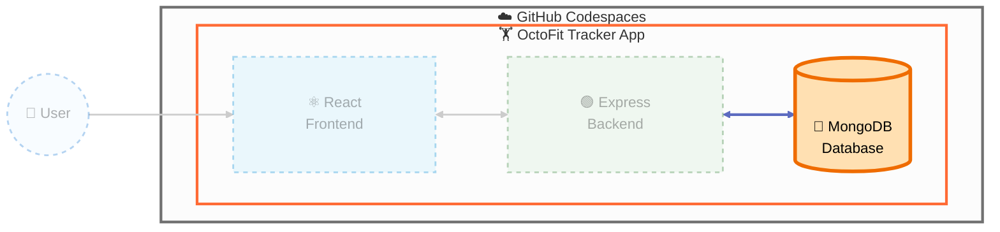

## Step 2: Implement the MongoDB data tier

Continue on the `build-octofit-app` branch and keep each Copilot request bounded by the tests for this tier.



> **🎯 Current Focus:** In this step, we're implementing the **MongoDB data tier**: Mongoose models and repeatable seed data.

### 📖 Theory: Model invariants and representative data

Mongoose schemas should express the rules the rest of the application can rely on, not merely mirror arbitrary JSON. Relationships and validation for activities, teams, leaderboard inputs, and workout suggestions make downstream API behavior predictable. Focused model tests and representative seed data expose schema mistakes before they become HTTP or UI bugs.

### ⌨️ Activity: Implement the MongoDB data tier

1. Read the data-contract tests and the existing model stubs in `octofit-tracker/backend`.

1. Ask Copilot for a bounded data-tier plan.

   > 
   >
   > ```text
   > Explain why the data-tier tests fail and propose changes limited to Mongoose models and seed data. Preserve the contracts and do not edit API or React files.
   > ```

1. Implement schemas and seed records in small changes, running the data tests after each capability. Use stable fixture keys and upserts so rerunning the seed preserves unrelated MongoDB records.

   > 
   >
   > ```bash
   > npm run test:data --prefix octofit-tracker/backend
   > ```

1. Load the representative records into the Codespace MongoDB instance and run the command twice to confirm it is idempotent.

   > 
   >
   > ```bash
   > npm run seed --prefix octofit-tracker/backend
   > npm run seed --prefix octofit-tracker/backend
   > ```

1. Review the diff for validation rules and realistic relationships, then commit and push.

<details>
<summary>Having trouble? 🤷</summary><br/>

- Use Mongoose models rather than raw MongoDB scripts.
- Seed all four capabilities and keep repeated seed runs idempotent.
- Diagnose the first failing assertion instead of regenerating every model.

</details>
