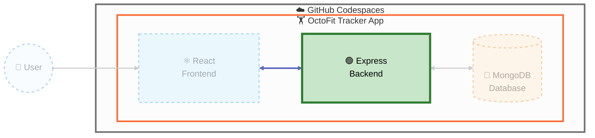

## Step 3: Implement and test the Express logic tier

Continue on the `build-octofit-app` branch and keep each Copilot request bounded by the tests for this tier.



> **🎯 Current Focus:** In this step, we're implementing the **Express Backend**: the API behavior that the React frontend calls.

### 📖 Theory: APIs encode behavior, not just routes

The logic tier owns request validation, business rules, status codes, and error responses. Supertest contract tests make those decisions observable without requiring a browser and prevent an endpoint from passing merely because its route string exists. Implement one capability at a time and use test output to refine Copilot's changes.

### ⌨️ Activity: Implement and test the Express logic tier

1. Inspect the route stubs, service stubs, and API contract tests.

   The activity-create contract takes `userId` and `teamId` for existing records. The contract tests already create valid team and user fixtures before posting an activity; implement against them instead of editing them or inventing name-resolution behavior.

1. Ask Copilot to start with one failing API behavior.

   > 
   >
   > ```text
   > Start with the first failing API contract test. Explain the expected behavior, implement only that behavior, and show which test to run next.
   > ```

1. Repeat the test/change/review loop for activities, teams, leaderboard, and workout suggestions.

   > 
   >
   > ```bash
   > npm run test:api --prefix octofit-tracker/backend
   > ```

1. In a dedicated terminal, start the backend on port 8000 and leave it running.

   > 
   >
   > ```bash
   > npm run dev --prefix octofit-tracker/backend
   > ```

1. In a second terminal, verify one successful request and one validation failure.

   > 
   >
   > ```bash
   > curl http://localhost:8000/api/activities
   > curl -i -X POST http://localhost:8000/api/activities -H "Content-Type: application/json" -d "{}"
   > ```

1. Commit and push the tested API.

<details>
<summary>Having trouble? 🤷</summary><br/>

- Keep routes under `/api/`.
- Return deliberate 4xx responses for invalid input instead of success-shaped fallbacks.
- Keep Codespaces and localhost behavior in one configuration helper.

</details>
