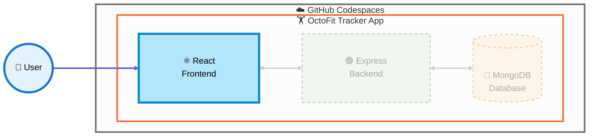

## Step 4: Build and test the React presentation tier

Continue on the `build-octofit-app` branch and keep each Copilot request bounded by the tests for this tier.



> **🎯 Current Focus:** In this step, we're building the **React Frontend** and connecting it to the user experience.

### 📖 Theory: UI states are part of the contract

The presentation tier should make loading, empty, success, and error states visible while keeping API URL construction out of individual components. React Router provides navigable capability views, and component tests prove that API data becomes accessible, meaningful interface output. Testing these states makes Copilot-generated UI easier to trust and maintain.

### ⌨️ Activity: Build and test the React presentation tier

1. Inspect the shared API client, route stubs, and component tests.

1. Ask Copilot for the smallest UI change from one failing test.

   > 
   >
   > ```text
   > Use the failing frontend test to implement the smallest UI change. Reuse the shared API client and preserve loading, empty, and error states.
   > ```

1. Repeat for activities, teams, leaderboard, and workout suggestions. Every route needs loading, empty, success, and error states, and workout suggestions must call `/api/workouts/suggestions/:userEmail` for a seeded user such as `mona@example.com`.

   > 
   >
   > ```bash
   > npm test --prefix octofit-tracker/frontend
   > ```

1. Build and manually inspect the Vite app on port 5173.

   > 
   >
   > ```bash
   > npm run build --prefix octofit-tracker/frontend
   > npm run dev --prefix octofit-tracker/frontend -- --host 0.0.0.0
   > ```

   <details>
   <summary>No data displayed? Ensure the backend is running</summary><br/>

   The React app calls relative `/api` paths and the Vite dev server forwards them to the Express backend on port 8000. If no data is displayed, or every view shows an error, the backend may not be running.

   1. **Check if the backend is already running:**
      - Look at the **Ports** tab in VS Code: port 8000 should be listed and forwarded.
      - Or check your terminals for a running `npm run dev --prefix octofit-tracker/backend`.

   1. **If the backend is NOT running, start it in a dedicated terminal:**

      ```bash
      npm run dev --prefix octofit-tracker/backend
      ```

      Or open the **Run and Debug** panel (`Ctrl+Shift+D` or `Cmd+Shift+D`), select **Launch Express Backend**, and click the green **Start Debugging** button (▶️).

   1. **If the backend is running but the lists are empty:**
      - Confirm MongoDB is running with `ps aux | grep mongod`.
      - Load the representative records with `npm run seed --prefix octofit-tracker/backend`.

   > [!IMPORTANT]
   > Keep the Express backend running in a separate terminal or debug session while you work with the React frontend.

   </details>

1. Commit and push the presentation tier.

<details>
<summary>Having trouble? 🤷</summary><br/>

- Keep the shared API client on relative `/api` paths (with an optional `import.meta.env.VITE_API_BASE_URL` override). The Vite proxy forwards them to port 8000, which stays private.
- Keep fetch logic out of repeated components: each route component imports `getJson` from `src/api/client.ts` and never calls `fetch` directly.
- Check accessible names and semantic status/error output when tests fail.

</details>
