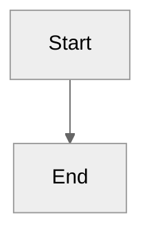
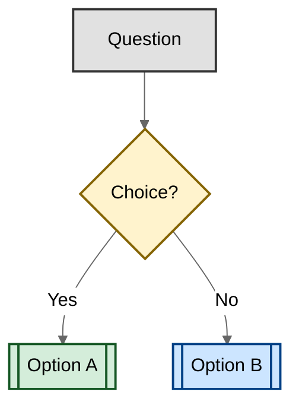

# AGENTS.md

GitHub Copilot agent mode workshop: Build and test an OctoFit Tracker fitness app with a React (Vite) frontend, an Express + TypeScript backend, and a MongoDB database in GitHub Codespaces, working from the architecture notes in `docs/architecture.md` and the executable contract tests.

## Boundaries

⚠️ **Ask first:**

- Modifying `.github/workflows/` (affects exercise validation)
- Changing `.github/instructions/` (affects other Copilot sessions)
- Modifying exercise steps in `.github/steps/` (affects workshop flow)
- Modifying `.github/scripts/` (grading and exercise validation)

🚫 **Never:**

- Using ports other than 8000 (Express API), 5173 (Vite frontend), 27017 (MongoDB)
- Editing the protected contracts to make tests pass: `octofit-tracker/backend/tests/*.contract.test.ts`, `octofit-tracker/frontend/tests/app.contract.test.tsx`, both `tsconfig.json` files, and `octofit-tracker/frontend/vite.config.ts`
- Installing dependencies outside `octofit-tracker/backend/` and `octofit-tracker/frontend/` (run npm commands from the repository root with `--prefix octofit-tracker/<tier>`)
- Modifying `.devcontainer/` configuration

## Documentation Standards

- Use ATX-style headers (`#` not `===`)
- One sentence per line for easier diffs
- Use relative links for internal references
- Use neutral theme for Mermaid diagrams:

````markdown

````

- Use colors to improve diagram readability (decisions, outcomes, categories):

````markdown

````

## Troubleshooting

Use the troubleshooting prompt for automatic fixes:

```text
/fix-step <step_number>
```

See [TROUBLESHOOTING.md](.github/TROUBLESHOOTING.md) for detailed guidance.

## Additional Guidance

- **Architecture and API contract**: Read [docs/architecture.md](docs/architecture.md) for tier boundaries, ports, and application requirements
- **Exercise flow**: Any changes to workshop steps must be made in [.github/steps/](.github/steps/)
