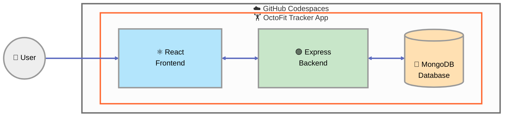

  <picture>
    <source media="(prefers-color-scheme: dark)" srcset="images/flai-logo-dark.svg?v=2" />
    <source media="(prefers-color-scheme: light)" srcset="images/flai-logo-light.svg?v=2" />
    
</picture>
   
   
  <a href="https://flai.gh.nos.pt/">https://flai.gh.nos.pt</a>

# Build and test a multi-tier application with GitHub Copilot

_Use GitHub Copilot agent mode to implement, test, and review a React + Express + MongoDB application from executable contracts._

## Welcome

- **Who is this for**: Developers comfortable with GitHub, VS Code, JavaScript/TypeScript, and basic GitHub Copilot workflows.
- **What you will learn**: How to use Copilot agent mode as an engineering partner while preserving architecture boundaries, working from tests, validating generated code, and reviewing a multi-tier change.
- **What you will build**: OctoFit Tracker with activity tracking, team management, a competitive leaderboard, and personalized workout suggestions.
- **Prerequisites**:
  - [Getting Started with GitHub Copilot](https://github.com/nosportugal/flai-workshop-github-copilot-100)
  - Familiarity with React, HTTP APIs, and automated tests.
  - Access to [GitHub Codespaces](https://github.com/features/codespaces).
- **How long**: 90–120 minutes, depending on your GitHub Copilot familiarity.

## Application Architecture

In this exercise, you will:

1. Explain and preserve presentation, logic, and data-tier boundaries.
1. Use failing tests and explicit contracts to bound Copilot's work.
1. Implement and test Mongoose data models and representative seed data.
1. Implement and test Express API behavior, including validation and error states.
1. Implement and test React routes and API-driven user experiences.
1. Verify the integrated system and review a multi-tier pull request before merging.

### How to start this exercise

Simply copy the exercise to your account, then give your favorite Octocat (Mona) **about 20 seconds** to prepare the first lesson, then **refresh the page**.

Having trouble? 🤷
 

When copying the exercise, we recommend the following settings:

- For owner, choose your personal account or an organization to host the repository.
- We recommend creating a public repository, since private repositories will use Actions minutes.
- If the exercise is not ready in 20 seconds, open the **Actions** tab in your copied repository.
- If a job failed, rerun it once. If it fails again, open an issue with the workflow log link.

---

&copy; 2025 GitHub &bull; [Code of Conduct](https://www.contributor-covenant.org/version/2/1/code_of_conduct/code_of_conduct.md) &bull; [MIT License](https://gh.io/mit)
